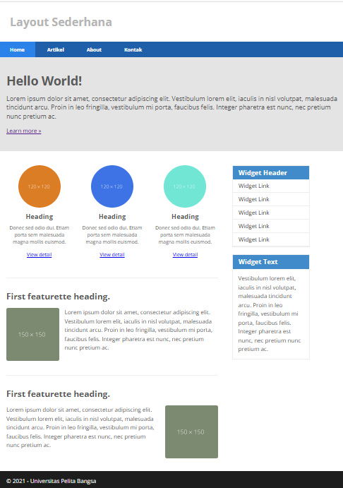
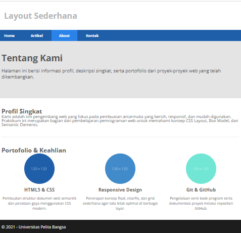
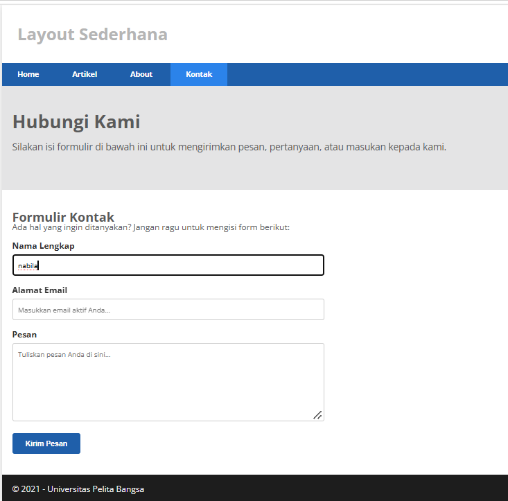

# Praktikum 4: CSS Layout

**Nama:** Nabila Lutfia Sari  
**NIM:** 312510040  
**Kelas:** I253A
**Mata Kuliah:** Pemrograman Web  

---

## Deskripsi Praktikum
Praktikum ini membahas tentang pembuatan kerangka layout web menggunakan **CSS Box Model**, **CSS Floating**, **Clearfix**, serta **HTML5 Semantic Elements** (`<header>`, `<nav>`, `<section>`, `<aside>`, `<footer>`).

---

## Struktur File Repositori

```text
Lab4Web/
├── lab4_box.html       # Latihan dasar Box Element & CSS Float
├── home.html           # Halaman utama (Landing Page)
├── about.html          # Halaman tentang profil & portofolio
├── kontak.html         # Halaman form kontak
├── style.css           # Stylesheet CSS eksternal
├── screenshots/        # Folder bukti tangkapan layar
└── README.md           # Laporan praktikum

---

## **Langkah-Langkah Praktikum**

### 1. Latihan Box Element & Float (`lab4_box.html`)
* Membuat elemen kotak menggunakan tag `<div>`.
* Menerapkan properti `float: left` untuk menyusun kotak secara mendatar serta `clear: left` untuk menghentikan efek *floating*.
* **Hasil Screenshot:**
  

---

### 2. Tampilan Halaman Utama / Home (`home.html` & `style.css`)
* Membangun struktur layout web semantik lengkap dengan *Header*, *Navigation*, dan *Hero Panel* (*Hello World!*).
* Mengatur dua kolom utama (*main content* dan *sidebar widget*) menggunakan CSS *Float*.
* Menambahkan bagian box elemen, artikel, dan *footer*.
* **Hasil Screenshot:**
  

---

### 3. Tampilan Halaman About (`about.html`)
* Membuat layout untuk menu *About* yang berisi deskripsi profil singkat dan portofolio keahlian.
* **Hasil Screenshot:**
  

---

### 4. Tampilan Halaman Kontak (`kontak.html`)
* Membuat layout untuk menu *Contact* yang dilengkapi dengan formulir interaktif (nama, email, pesan) dan tombol *submit*.
* **Hasil Screenshot:**
  

---

## **Pertanyaan dan Tugas**

1. **Tambahkan Layout untuk menu About! (buat single layout yang berisi deskripsi, portfolio, dll)**
   * **Jawaban:** Telah dibuat file `about.html` dengan tata letak bersih yang menampilkan deskripsi profil tim pengembang serta portofolio keahlian (HTML5 & CSS, Responsive Design, dan Git/GitHub).

2. **Tambahkan layout untuk menu Contact! (yang berisi form isian: nama, email, message, dll)**
   * **Jawaban:** Telah dibuat file `kontak.html` yang dilengkapi dengan formulir interaktif meliputi *input Name*, *Email*, *Textarea Message*, serta tombol *Submit/Kirim Pesan*.
